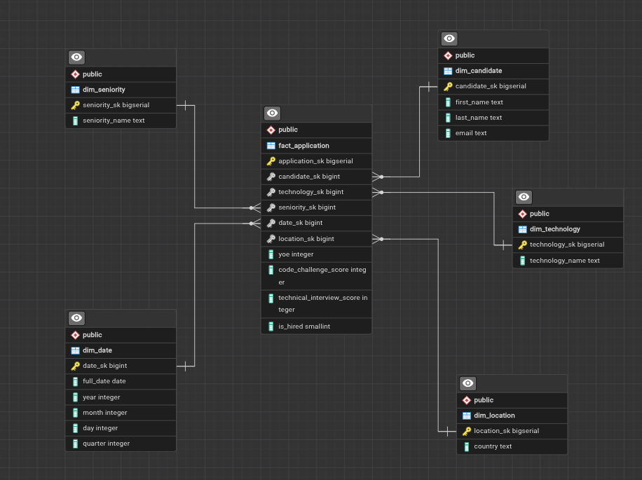
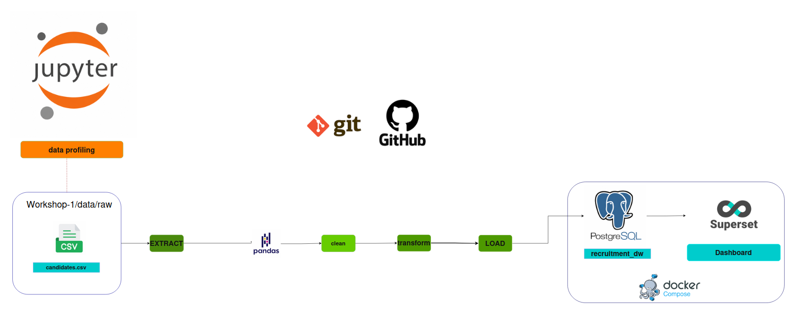
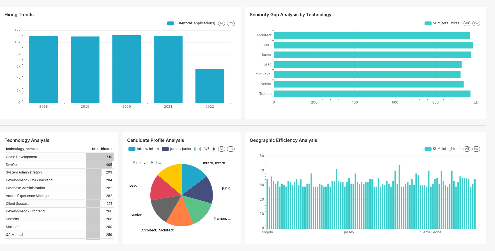

# Workshop 1: Technology Recruitment Data Warehouse

## 1. Project Objective

Design and implement a Dimensional Data Warehouse (Star Schema) for a technology recruitment company. The system must transform raw candidate application data into analytical information that allows the organization to understand its hiring patterns and evaluate recruitment performance from different perspectives (technology, candidate profile, geographic location, and time).

## 2. Business Context

The company receives thousands of applications from candidates with diverse profiles. Currently, data is stored in raw files, making analysis difficult. A centralized system is needed to allow decision-makers to answer key questions about the hiring process.

## 3. Business Requirements

Five key analytical requirements have been defined:

*   **R1 – Hiring Trends:** Monitor hiring trends over time to identify changes in recruitment outcomes.
*   **R2 – Technology Analysis:** Compare hiring results across different technologies to identify which technical profiles generate the largest number and proportion of hired candidates.
*   **R3 – Candidate Profile Analysis:** Analyze hiring outcomes according to candidate seniority and years of professional experience to identify differences across candidate profiles.
*   **R4 – Geographic Efficiency Analysis:** Identify countries with the highest application volume and compare their hiring rates to evaluate the effectiveness of international recruitment strategies.
*   **R5 – Seniority Gap Analysis by Technology:** Detect whether the right seniority profile (Junior, Mid-Level, Senior) is being hired for each technology stack.

## 4. Requirements Traceability

| Requirement | Business Question | Data Required | Expected Analytical Output |
| :--- | :--- | :--- | :--- |
| **R1** | How has the number of hires varied over the years? | `Application Date`, `is_hired` | Line or bar chart of hires per year/quarter. |
| **R2** | Which technologies have the highest hiring rate? | `Technology`, `is_hired` | Comparative bar chart of hiring rate by technology. |
| **R3** | How do seniority level and years of experience influence the probability of being hired? | `Seniority`, `YOE`, `is_hired` | Table or chart crossing seniority, YOE, and hiring rate. |
| **R4** | In which countries are we most efficient at hiring? | `Country`, `is_hired` | Map or bar chart of hiring rate by country. |
| **R5** | Which seniority level is hired most for each technology? | `Technology`, `Seniority`, `is_hired` | Stacked bar chart of hires by technology and seniority. |

## 5. Dataset Description

The source dataset (`candidates.csv`) contains approximately **50,000 application records**. Each row represents a unique application.

**Attributes:**
*   `First Name`, `Last Name`, `Email`
*   `Country`
*   `Application Date`
*   `YOE` (Years of Experience)
*   `Seniority`
*   `Technology`
*   `Code Challenge Score` (0–10)
*   `Technical Interview Score` (0–10)

## 6. Main Data Profiling Findings

*   **Structure:** 50,000 rows, 10 columns. No null values.
*   **Dates:** Application date range is from **2018-01-01 to 2022-07-04**.
*   **Duplicates:** No fully duplicated rows, but **165 duplicated emails with inconsistent information** were found (different names, countries, etc.). This suggests the data is synthetic and must be handled during transformation.
*   **Experience (YOE):** Range from 0 to 30 years, with a median of 15 years.
*   **Scores:** Both scores range from 0 to 10, with an average of 5.0.
*   **Business Rule (Hired):** The rule `Hired = (Code Challenge Score >= 7) AND (Technical Interview Score >= 7)` will be implemented.

## 7. Business Process

The business process analyzed is the **candidate selection process**. The central event is the **application of a candidate** to a technology position.

## 8. Grain Definition

**One row in the `fact_application` table represents a single application submitted by a candidate for a specific technology, at a specific seniority level, for a specific location (country), on a given application date.**

This grain is the most atomic level available in the source data: each record corresponds to one unique application event. All dimensions (`dim_candidate`, `dim_technology`, `dim_seniority`, `dim_date`, `dim_location`) and all measures (`yoe`, `code_challenge_score`, `technical_interview_score`, `is_hired`) are fully compatible with this grain.

## 9. Star Schema Diagram



## 10. Dimensions and Facts Explanation

### Fact Table: `fact_application`
*   **Grain:** One candidate application.
*   **Measures:**
    *   `yoe`: Candidate's years of experience.
    *   `code_challenge_score`: Code challenge score.
    *   `technical_interview_score`: Technical interview score.
    *   `is_hired`: Binary flag (1 if hired, 0 if not).
*   **Foreign Keys:** `candidate_sk`, `technology_sk`, `seniority_sk`, `date_sk`, `location_sk`.

### Dimension Tables
*   **`dim_candidate`**: Stores candidate identification information (`email`, `first_name`, `last_name`).
*   **`dim_technology`**: Stores technology name (`technology_name`).
*   **`dim_seniority`**: Stores seniority level (`seniority_name`).
*   **`dim_date`**: Standard date dimension (`full_date`, `year`, `month`, `day`, `quarter`).
*   **`dim_location`**: Stores application country (`country`).

## 11. ETL Architecture

The data flow is as follows:

1.  **Extract:** Read the `candidates.csv` file using Pandas.
2.  **Transform:** Apply the following transformations:
    *   Data cleaning (handling duplicated emails).
    *   Implementation of the `is_hired` business rule.
    *   Creation of dimension tables and the fact table.
    *   Generation of surrogate keys for each dimension.
    *   Mapping of surrogate keys to the fact table.
3.  **Load:** Load dimensions first, then the fact table into PostgreSQL.



## 12. Key Transformation Decisions

*   **Handling Duplicated Emails:** Since duplicated emails have inconsistent information, each row is treated as a unique application. A `candidate_sk` is created for each unique combination of `first_name`, `last_name`, and `email` to group applications from the same person. If inconsistency persists, they are treated as different candidates.
*   **Surrogate Key Generation:** `ROW_NUMBER()` or `IDENTITY` in the database will be used to generate surrogate keys for each dimension, ensuring natural keys are not used.
*   **Date:** The `Application Date` column will be converted to `DATE` type and decomposed into the `dim_date` dimension.

## 13. Analytical Dashboard

The dashboard presents the main recruitment KPIs generated from the star schema and the analytical queries in `By_analytics/Queries/BI.sql`.



### Dashboard Views

* **Hiring Trends:** Compares the number of applications by year to identify changes in recruitment volume.
* **Seniority Gap Analysis by Technology:** Shows the number of hires by seniority level to compare hiring outcomes across profiles.
* **Technology Analysis:** Ranks technologies by total hires and highlights the strongest recruitment results.
* **Candidate Profile Analysis:** Shows the distribution of applications by seniority and supports comparison of candidate profiles.
* **Geographic Efficiency Analysis:** Compares hiring results across countries to identify geographic differences.

The dashboard is based on `fact_application` and its related dimensions: date, technology, seniority, candidate, and location. The `is_hired` metric follows the business rule defined in the transformation step: both the code challenge and technical interview scores must be at least 7.

## 14. Technologies Used

*   **Language:** Python 3.12
*   **Data Manipulation:** Pandas, NumPy
*   **Database:** PostgreSQL
*   **Visualization:** Power BI / Tableau / Looker Studio
*   **Version Control:** Git and GitHub

## 15. Instructions to Run the Project

1.  Clone the repository:
    ```bash
    git clone <REPOSITORY_URL>