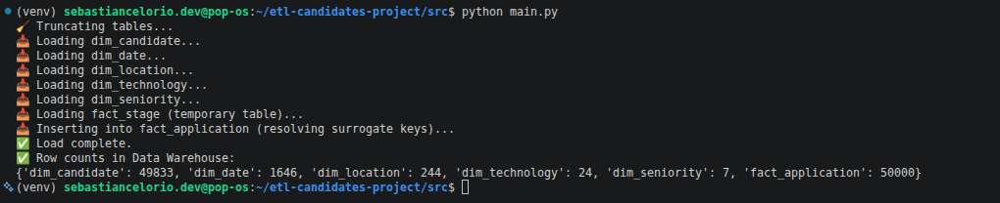

# 📊 Candidate Recruitment Analytics - ETL Workshop

## 📌 Project Overview

This project implements an end-to-end **ETL (Extract, Transform, Load)** pipeline that processes **50,000 candidate applications** and loads the cleaned data into a **PostgreSQL Data Warehouse** using a **Star Schema** dimensional model.

The entire infrastructure is containerized with **Docker Compose**, providing a complete environment for data processing and business intelligence.

### Key Features

- 📥 Extracts 50,000 candidate application records from a CSV dataset.
- 🧹 Cleans and validates the data using Pandas.
- 🔄 Applies business rules and data transformations.
- 🐘 Loads the processed data into a PostgreSQL Data Warehouse.
- ⭐ Implements a Star Schema dimensional model.
- 📊 Visualizes KPIs using Apache Superset.
- 🐳 Uses Docker Compose for easy deployment.

---

# 🏗️ Architecture

```text
                 Raw CSV Dataset
                        │
                        ▼
                  Extract (Python)
                        │
                        ▼
                 Transform (Pandas)
                        │
                        ▼
               Load (SQLAlchemy)
                        │
                        ▼
          PostgreSQL Data Warehouse
                        │
                        ▼
           Apache Superset Dashboard
```

---

# ⭐ Star Schema

The Data Warehouse follows a **Star Schema** design optimized for analytical queries.

### Fact Table

**fact_application**

Measures

- Years of Experience
- Code Challenge Score
- Technical Interview Score
- Hiring Status

### Dimension Tables

- dim_candidate
- dim_location
- dim_technology
- dim_seniority
- dim_date

---

# 🖼️ Star Schema Diagram

<p align="center">
    
</p>

---

# ⚙️ ETL Pipeline

The ETL workflow is orchestrated from:

```bash
python src/main.py
```

## 📥 Extract

- Reads the raw CSV dataset.
- Validates the dataset structure.
- Loads the data into a Pandas DataFrame.

## 🔄 Transform

Business rules include:

- Normalize column names.
- Normalize text values.
- Remove duplicate candidates.
- Generate the **is_hired** flag.
- Correct inconsistent seniority values.
- Convert dates.
- Export a cleaned CSV dataset.

## 📤 Load

The ETL automatically:

- Connects to PostgreSQL.
- Creates the Data Warehouse if it does not exist.
- Loads dimension tables.
- Generates surrogate keys.
- Loads the fact table.

---

# 🐳 Docker Infrastructure

The project uses Docker Compose to orchestrate all required services.

| Service | Description |
|----------|-------------|
| 🐘 PostgreSQL | Data Warehouse |
| 📊 Apache Superset | Business Intelligence Dashboard |
| ⚡ Redis | Superset Cache |

Start all services with:

```bash
docker compose up -d
```

---

# 🚀 Getting Started

## 1. Clone the repository

```bash
git clone https://github.com/sebastianceloriolopezdevdata-hub/etl-candidates-project.git

cd etl-candidates-project
```

---

## 2. Start Docker

```bash
docker compose up -d
```

This command starts:

- PostgreSQL
- Apache Superset
- Redis

Verify the containers:

```bash
docker ps
```

---

## 3. Create a Python Virtual Environment

Linux / macOS

```bash
python -m venv .venv

source .venv/bin/activate
```

Windows

```powershell
.venv\Scripts\activate
```

---

## 4. Install Dependencies

```bash
pip install -r requirements.txt
```

---

## 5. Configure Environment Variables

Create a `.env` file in the project root.

```env
DB_HOST=localhost
DB_PORT=5432
DB_NAME=candidates_dw
DB_USER=postgres
DB_PASSWORD=postgres
```

---

## 6. Execute the ETL

```bash
python src/main.py
```

---

# 📊 Dashboard

Once the ETL finishes successfully, the processed data is available in **Apache Superset** for interactive visualization.

Example KPIs include:

- Hires by Technology
- Hires by Country
- Hires by Seniority
- Hires by Year
- Average Technical Scores
- Hiring Rate

---

# 📷 Dashboard Preview

<p align="center">
    
</p>

---

# 🎥 Project Demonstration

Watch the complete ETL pipeline execution, PostgreSQL Data Warehouse loading, and Apache Superset dashboard demonstration.

<p align="center">
    <a href="https://www.youtube.com/watch?v=sWlpLfIKmGI">
        
    </a>
</p>

<p align="center">
    <strong>▶ Click the image above to watch the complete demonstration on YouTube.</strong>
</p>

**Direct link:** https://www.youtube.com/watch?v=sWlpLfIKmGI

---

# 📁 Project Structure

```text
etl-candidates-project/
│
├── data/
│   ├── raw/
│   └── processed/
│
├── diagrams/
│   ├── star_schema_dw.png
│   ├── etl-completed.png
│   └── dashboard.mp4
│
├── docker/
│
├── notebooks/
│
├── sql/
│
├── src/
│   ├── extract.py
│   ├── transform.py
│   ├── load.py
│   └── main.py
│
├── docker-compose.yml
├── requirements.txt
├── .env.example
└── README.md
```

---

# 🛠️ Technologies Used

- Python
- Pandas
- SQLAlchemy
- PostgreSQL
- Docker
- Docker Compose
- Apache Superset
- Redis

---

# 📈 Workflow

```text
CSV Dataset
      │
      ▼
Extract
      │
      ▼
Transform
      │
      ▼
PostgreSQL Data Warehouse
      │
      ▼
Apache Superset
      │
      ▼
Interactive Dashboard
```